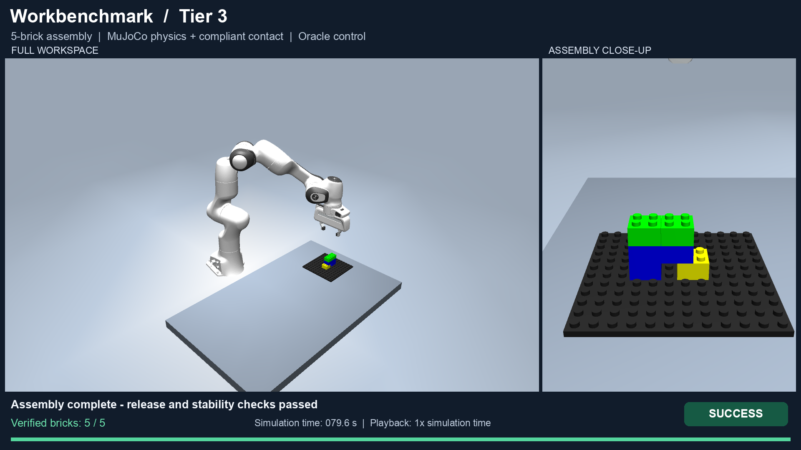

# LEGO Bench: Workbenchmark manipulation with Panda and MuJoCo

LEGO Bench provides a ROS 2 / MuJoCo environment for developing and evaluating
LEGO-style manipulation methods. A product YAML defines the assembly target;
the environment generates the scene, exposes robot and observation interfaces,
and scores the resulting structure. It includes a guarded reference controller
and adapters for the [Workbenchmark task dataset](https://github.com/ma-haha-hehe/benchmark_lego).

The environment supports planning and control experiments with simulation state,
and provides RGB-D interfaces for perception methods. The reference controller
uses simulated poses and contact forces. It is a baseline for studying execution,
not a learned policy or a demonstration of real-robot generalization.

[中文使用指南](docs/PUBLIC_BENCHMARK_ZH.md) ·
[Workbenchmark integration](docs/WORKBENCHMARK_INTEGRATION_ZH.md) ·
[Execution state machine](docs/EXECUTION_STATE_MACHINE_ZH.md) ·
[Evaluation guide](docs/VALIDATION_ZH.md)

## Assembly demonstration

[](docs/media/workbenchmark-tier3-demo.mp4)

[Watch or download the video](https://raw.githubusercontent.com/ma-haha-hehe/robot_korea/main/docs/media/workbenchmark-tier3-demo.mp4)
· [Demonstration details](docs/media/README.md)

The reference controller assembles the five-brick Tier 3 task
`simple_shape_assembly_056` with MuJoCo rigid-body dynamics and plastic contact.
The two camera views show the same execution at 1× simulation time; the video
lasts about 88 seconds. The controller uses Oracle poses and contact forces.
This example illustrates the execution pipeline; it does not establish a
dataset-wide success rate, a learned-policy result or real-hardware performance.

## What the repository contains

- Product validation, normalization, geometry auditing and deterministic scene generation.
- Registered `brick_2x2` and `brick_4x2` parts, a Panda arm and a two-finger hand.
- Oracle and RGB-D observations, ROS trajectory actions, reset and scoring services.
- Assembly-by-disassembly planning with 0°/90° grasp directions.
- A torque-controlled execution baseline with measured grasp/release checks,
  collision screening, bounded recovery and final stability checks.
- Simplified snap, loose rigid-body and compliant plastic-contact configurations.
- Frozen task sampling, bounded parallel execution, independent result auditing,
  CSV export and comparisons on identical inputs.

This repository contains the simulation software and representative product
YAMLs. The complete, versioned task collection and its images belong to
[`benchmark_lego`](https://github.com/ma-haha-hehe/benchmark_lego).

## Installation

Use Ubuntu 22.04 with ROS 2 Humble installed and its apt repository configured.
The simulator depends on MuJoCo 3.11.0; Python dependencies are pinned in
[`requirements-sim.txt`](requirements-sim.txt). The installation script uses
`sudo` for system packages and creates a local `.venv`.

```bash
git clone https://github.com/ma-haha-hehe/robot_korea.git
cd robot_korea
bash install_sim_system_deps.sh
source enter_sim_env.sh
colcon build --base-paths src/mj_bridge --packages-select mj_bridge --symlink-install
source enter_sim_env.sh
export PYTHONPATH="$PWD/src/mj_bridge:$PYTHONPATH"
```

Source `enter_sim_env.sh` in each new terminal. If the installed command is not
on `PATH`, use `python -m mj_bridge.benchmark_cli` in place of `lego-bench`.
ROS packages come from apt rather than PyPI. A Mac can host the editor while
these commands run in an Ubuntu SSH session; the simulation process and its
files then remain on Ubuntu. See the [workspace guide](docs/WORKSPACE_SNAPSHOT_ZH.md).

## Run a first example

Validate the product and inspect its nominal geometry before running:

```bash
lego-bench validate examples/products/traffic_light.yaml
lego-bench audit examples/products/traffic_light.yaml
lego-bench generate --product examples/products/traffic_light.yaml \
  --seed 42 --output-dir runs/traffic-light-scene
lego-bench run --product examples/products/traffic_light.yaml --seed 42 \
  --headless --executor oracle-baseline --connection-mode physics \
  --output-dir runs/traffic-light-physics
```

`--executor oracle-baseline` executes the reference controller automatically.
The default `external` executor starts the environment and waits for another
method to command the robot. Always choose a fresh output directory when
keeping comparable experiments.

To watch a physics episode on an Ubuntu desktop:

```bash
MUJOCO_GL=glfw LP_NUM_THREADS=2 python scripts/view_physics_episode.py \
  --product examples/products/catalog/final_product_hammer.yaml --seed 42
```

The viewer stays open after execution. `--speed-scale` accepts 0.25–2; contact
insertion retains its slower motion schedule. Viewer output is a preview;
use the batch or CLI entry points for repeatable evaluation.

## Execute a plastic-contact Workbenchmark example

```bash
export MJ_BRIDGE_BENCHMARK_CONFIG="$PWD/examples/config/plastic_benchmark.yaml"
python -m mj_bridge.benchmark_cli run \
  --product examples/products/workbenchmark/tier2_task_001.yaml \
  --seed 42 --headless --executor oracle-baseline \
  --connection-mode physics --contact-profile plastic --robot-base-x=-.05 \
  --output-dir runs/workbenchmark-plastic
```

The base offset moves the simulated robot 5 cm along negative world X; it does
not move the target or loose parts. Plastic contact uses compliant ribs and
friction rather than attachments. Its material parameters are uncalibrated
simulation settings. Dense contact can consume substantial CPU time; the
example configuration allows a 3600-second episode budget without changing
the timestep or acceptance limits. See [contact modeling](docs/PLASTIC_CONTACT_ZH.md).

## Import the current Workbenchmark dataset

Clone the dataset alongside this repository, or substitute its actual path:

```bash
git clone https://github.com/ma-haha-hehe/benchmark_lego.git ../benchmark_lego
python scripts/import_workbenchmark_latest.py \
  --tasks-root ../benchmark_lego/versions/latest/tasks \
  --output runs/workbenchmark-import
python scripts/import_workbenchmark_latest.py \
  --output runs/workbenchmark-import --verify-task two_brick_stack_001.yaml
```

The current dataset contains 400 tasks across four tiers. Each source instance
has `final_product.yaml`, `scene_init.yaml` and `metadata.yaml`. The importer
freezes these inputs and hashes, preserves relative XY geometry and the
recorded starting layout, and explicitly maps the source 20 mm layer spacing
to the simulator's 19.2 mm spacing. This adaptation is recorded in the import
manifest. Successful import is a data-integrity check, not an execution result.

Select and execute a reproducible Tier 1–3 sample:

```bash
python scripts/select_workbenchmark_sample.py \
  --products runs/workbenchmark-import --output-dir runs/workbenchmark-selection \
  --tiers 1 2 3 --per-tier 6 --seed 42
python scripts/run_workbenchmark_sample.py \
  --products runs/workbenchmark-selection --output-dir runs/workbenchmark-sample \
  --jobs 2 --episode-timeout 900 --ros-domain-base 200
python scripts/report_workbenchmark_sample.py \
  --suite runs/workbenchmark-sample --products runs/workbenchmark-selection \
  --output-dir runs/workbenchmark-report
```

The runner uses isolated local ROS domains, freezes source/configuration
fingerprints, and stops its own workers at the deadline. The default overall
budget is four hours; `--deadline-utc` sets an absolute timezone-aware deadline.
Recorded layouts do not change when only the seed changes. Sampling and
report interpretation are described in the [state-machine guide](docs/EXECUTION_STATE_MACHINE_ZH.md).

The older `benchmark_tasks/*.yaml` format has a separate importer:

```bash
python scripts/import_workbenchmark.py --repository ../benchmark_lego \
  --initial-layout recorded --output runs/workbenchmark-legacy
```

Use the importer that matches the dataset version. Do not mix current and
legacy task IDs, layer conventions or evidence. See the
[integration guide](docs/WORKBENCHMARK_INTEGRATION_ZH.md).

## Connect an external method

Launch the Panda, MoveIt and ROS bridge:

```bash
ros2 launch mj_bridge lego_bench.launch.py \
  product:=$PWD/examples/products/traffic_light.yaml seed:=42 headless:=true \
  observation:=oracle connection_mode:=physics contact_profile:=loose
```

| Interface | ROS name |
|---|---|
| Arm trajectory action | `/mj_panda_arm_controller/follow_joint_trajectory` |
| Hand trajectory action | `/mj_panda_hand_controller/follow_joint_trajectory` |
| Joint states | `/joint_states` |
| Target JSON (`std_msgs/String`) | `/lego_bench/goal` |
| Oracle state JSON (`std_msgs/String`) | `/lego_bench/ground_truth` |
| RGB and depth images | `/camera/color/image_raw`, `/camera/depth/image_raw` |
| Camera calibration | `/camera/camera_info` |
| Simulation segmentation | `/camera/segmentation` |
| Reset / result services (`std_srvs/Trigger`) | `/mj_bridge/reset`, `/mj_bridge/result` |
| Live score JSON (`std_msgs/String`) | `/mj_bridge/benchmark_state` |

[`examples/external_executor.py`](examples/external_executor.py) is an Oracle
subscription skeleton: replace `policy()` with trajectory generation. It does
not implement a complete control policy. An RGB-D method should consume image
observations rather than the Oracle subscription. Segmentation is MuJoCo's
`32SC2` object-ID/object-type annotation, not an RGB-D perception prediction.
The full launch publishes the `world -> realsense` optical-frame transform.

Request a score after execution:

```bash
ros2 service call /mj_bridge/result std_srvs/srv/Trigger '{}'
```

For image-only observations, set `observation:=rgbd`. The optional
GroundingDINO/SAM/FoundationPose adapter and its installation requirements are
covered in the [evaluation guide](docs/VALIDATION_ZH.md). GPU inference and
real-robot operation require separate validation.

## Evaluate and extend

```bash
python -m pytest -q
python scripts/plan_assembly.py examples/products/catalog/final_product_hammer.yaml
python scripts/test_product_suite.py --seeds 0 17 42 --jobs 2 \
  --skip-invalid-products --connection-mode physics \
  --output-dir runs/product-suite
```

Evaluation distinguishes schema validity, nominal geometry, actual robot
execution, release/contact quality and final stability. Unit tests and static
checks do not establish a dataset-wide task success rate. Results must state
the controller version, exact inputs, observation mode, contact model, base
position and resource budget. See [evaluation scope](docs/RELEASE_STATUS_ZH.md)
and [physics criteria](docs/PHYSICS_VALIDATION_ZH.md).

`runs/` contains local experiment artifacts and is ignored by Git. A run can
include scene and input manifests, actual states, phase traces, timing,
per-part errors and a summary. Keep complete local outcomes when comparing
methods, including timeouts and unfinished cases; the source distribution
does not bundle individual execution logs.

Routine checks run locally. The GitHub Actions workflow is available only
through manual `workflow_dispatch`; it does not run on pushes or pull requests
and does not upload experiment artifacts. A manually started Actions run still
has the standard GitHub job log.

| Location | Purpose |
|---|---|
| `src/mj_bridge/mj_bridge/` | Core schema, scene builder, ROS bridge, planner, controller and scoring |
| `src/mj_bridge/launch/` | ROS launch entry points |
| `scripts/` | Import, plan, sample, run, inspect and report utilities |
| `examples/products/` | Small examples, legacy catalog and explicitly named variants |
| `examples/config/` | Alternative runtime configurations |
| `examples/validation/` | Input-selection manifest; not execution results |
| `docs/` | Installation, modeling, integration and evaluation guides |

Register additional parts through `part_registry.yaml`, visual/collision assets,
mass and symmetry metadata. Unknown types are rejected. The current baseline
uses bounded collision checks and recovery; it does not guarantee arbitrary
layouts or structures. Real hardware requires its own driver, calibration,
controller limits and validation rather than direct use of simulation commands.

## License

The public benchmark software and included Panda model use Apache-2.0; see
[`LICENSE`](LICENSE). FoundationPose has a separate NVIDIA license restricted
to non-commercial research/evaluation and must be installed separately.
Hardware SDK binaries, model weights, caches and real-robot data are excluded.
See [`THIRD_PARTY_NOTICES.md`](THIRD_PARTY_NOTICES.md) for component details.
