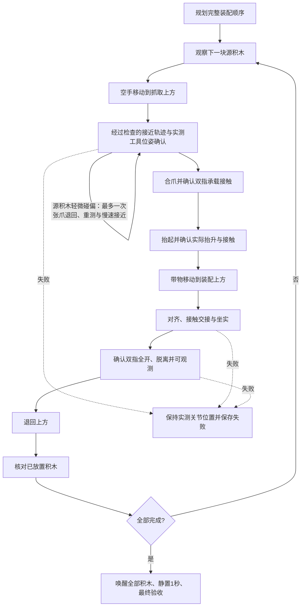

# 执行状态机与最新版数据集抽样

状态机在 `execution_phases.py`，机械臂控制在 `reference_executor.py`。
它约束每个积木的执行次序，并检查实际观测证据；不能把它理解成任务必然成功的保证。

## 状态与推进条件



未恢复的异常会锁定失败。抓取接近允许一次有界恢复。不能跳过松爪确认直接退回，不能在块数不足时进入最终验收，
失败后不能继续下一个状态。每块积木必须按规划 ID 顺序执行。

`alignment_and_insertion` 包含物理接触交接；塑料接触模式可能先松爪，再用闭合指尖从顶部压实。
后续 `release` 是退回前的最终松爪确认，并不表示所有任务第一次松爪都发生在这个状态。

当前验证的接触执行后端是 Oracle：直接读取仿真中的积木姿态和接触力。
视觉后端还没有验证在手姿态跟踪，因此不能把 Oracle 成功当作视觉或 VLA 成功。

## 运动与接触约束

- 接近后检查实测工具位姿；位置误差超过1毫米或姿态误差超过2°时不合爪。
- 检查源积木是否被空爪接近碰移；合爪后与抬升后检查双指实际承载接触。
- 源积木仍直立、水平位移不超过10毫米、离桌高度变化不超过1毫米且处于源区域内时，
  接近阶段可完全张爪、退回、重新测量位姿，并慢速重试一次。随后仍须通过原有位姿与接触检查。
- IK 拒绝机器人自碰撞及手臂与环境的碰撞配置；关节段按至多0.05弧度增量检查。
  直接转移被阻挡时，尝试等价 IK 或经过检查的关节中间点；找不到路径则停止。
  这是离散检查与有界备选路线，不是完整的连续碰撞或带物运动规划保证。
- 旋转验收检查真实朝向，避免叉积误差在相差180°时退化为零。
  塑料模式的对称双指夹爪选择较短的等价半圈姿态，减少抓取与转移时的腕部翻转。
- 塑料插入根据支撑几何降低速度，并用实际支撑接触中断下降。局部重放只能用于定位问题，必须重新跑完整任务才能计入验收。
- 空中姿态补偿先确认双指承载，把指令预紧力在0.1秒内逐步调整至1.5 N；补偿过程中持续复查抓持，
  下降中新出现倾斜会中断该段，转入原高度的姿态修正。接触交接前先逐步卸载指令预紧力，再开爪。
  这是当前塑料仿真的执行参数；结果记录接触有效性、最大穿透、支撑力和松爪测量。
- 顶部压实时，两指保留3毫米总间隙，并等待实测位置和速度稳定，避免空爪撞击闭合限位后互相穿透。
  倾斜的高位方块若具有至少1毫米的支撑中心裕量，先逐步卸载夹持预紧力再释放；
  支撑边缘上的方块仍采用受限的摩擦交接，并保留姿态与接触检查。
- 上层方块与已放置的同层积木投影间距不超过2毫米时，从约40毫米的上方间隙开始姿态补偿，
  在进入邻块高度前降低预紧力并修正姿态；它沿用双指接触、姿态和80步补偿上限。
- 对中心位于支撑内部或边界、中心裕量不足1毫米且至少有两格面积重叠的上层方块，
  实测离目标高0.4至3毫米、倾斜不超过1°、横向误差不超过0.5毫米时，
  可以保持1.5 N指令预紧力完成最多4毫米的受限插入，再逐步卸载并开爪。
  每次修正前复查双指承载，释放后必须取得真实支撑证据；失败后不能继续退回。
  直接下降与姿态补偿后的接触交接均执行同一检查，避免补偿分支提前开爪。
- 倾斜底层方块在高于目标2毫米时逐步卸载夹持预紧力，减少开爪瞬间的接触冲击；
  上层方块和长砖使用2.5毫米触发条件，姿态补偿的交接仍会卸载实际夹持预紧力。
- 实际接触穿透超过0.5毫米时停止。任务目标、容差、积木位置和材质参数不会因失败而自动修改。
- 成功要求末态满足 XY 1毫米、Z 0.4毫米、倾斜3°、对称性约束下偏航8°，
  并通过逐块释放、坐实支撑、最终全体可观测和1秒稳定性检查。

## 运行最新版 Tier 1–3 抽样

先在 Ubuntu 上激活 ROS 与仿真环境；以下假设两个仓库并列克隆：

```bash
source enter_sim_env.sh
export PYTHONPATH="$PWD/src/mj_bridge:$PYTHONPATH"
python scripts/import_workbenchmark_latest.py \
  --tasks-root ../benchmark_lego/versions/latest/tasks --output runs/latest-import
python scripts/select_workbenchmark_sample.py \
  --products runs/latest-import --output-dir runs/latest-selection \
  --tiers 1 2 3 --per-tier 6 --seed 42 \
  --include simple_multi_brick_stack_002
python scripts/run_workbenchmark_sample.py \
  --products runs/latest-selection --output-dir runs/latest-execution \
  --jobs 2 --episode-timeout 900 --ros-domain-base 200
python scripts/report_workbenchmark_sample.py \
  --suite runs/latest-execution --products runs/latest-selection \
  --output-dir runs/latest-report
```

每个输出目录必须全新，避免覆盖之前的证据。
`--tasks-root` 应指向所需 benchmark 版本的 `versions/latest/tasks`，不能混用旧 `benchmark_tasks`。
导入器冻结每个任务的三个源文件与哈希，显式把源层高20毫米映射为仿真层高19.2毫米，保持相对 XY 布局。

运行器固定使用 Oracle / physics / plastic、基座 X=-0.05米，不启用焊接或传送积木。
每个工作进程使用独立的本机 ROS domain。源码或输入哈希变化会使结果失效，后续任务停止执行。
`--episode-timeout` 限制单例墙钟时间；`--deadline-utc` 可设置带时区的绝对截止时间，
如 `YYYY-MM-DDTHH:MM:SSZ`；未指定时，整体运行预算为4小时。
收到 Ctrl+C、SIGTERM 或到达截止时间后，运行器停止派发并终止自己启动的进程组。

## 如何读结果

每个任务目录保留 `result.json`、`actual_state.json`、`episode_manifest.yaml`、
`assembly_plan.json`、`phase_trace.json` 和 `execution.log`。
失败保留 `failed_phase`、异常原因和较深的接触对，状态机会保持最后实测关节位置。
发生在手补偿时，`feedback_grip_control` 记录预紧力指令与过渡时长，
`pose_feedback` 记录补偿次数、空中回退次数及观测到的最大倾角。
`press_gripper_confirmation` 记录顶部压实前的双指间隙与稳定等待时间，
`controlled_release` 区分宽支撑上的预紧卸载与支撑边缘的摩擦交接。
`pose_feedback.trigger` 标识是否因同层近邻提前补偿，
`placement_mode: held_edge_insertion` 标识先保持夹持坐实、再卸载开爪的边缘插入。
`grasp_recoveries` 保存源积木接近重试的初始测量、扰动后位置、重试位置与结果，耗时包含在本例总时长中。
JSON 日志通过完整写入临时文件后替换，避免中断写入截断上一次有效记录。

总目录的 `summary.json` 区分成功、失败、未执行；`finished` 表示调度结束，
只有 `fully_executed` 才表示选中任务均有执行尝试，二者都不表示全部成功。
报告脚本重新核对末态、物理接触、释放与源码证据，并输出 `REPORT.md`、`episodes.csv`、`evidence.json`。
可加 `--baseline 旧运行目录` 比较完全相同抽样输入与 seed 的改善和回归。

记录式初始布局不会因更换 seed 自动重排。可以通过 `--include` 加入指定任务；有针对性的抽样
不能直接作为整个数据集成功率的无偏估计。完整数据集、实机和视觉泛化均需分别验证。
